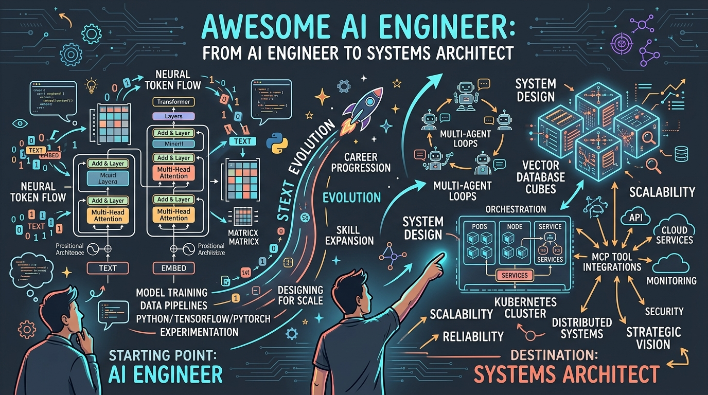
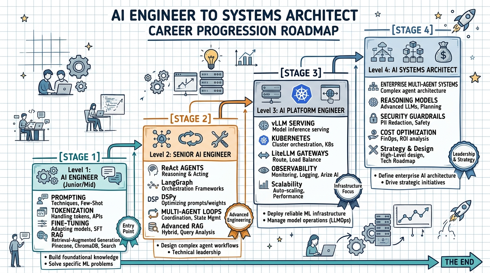
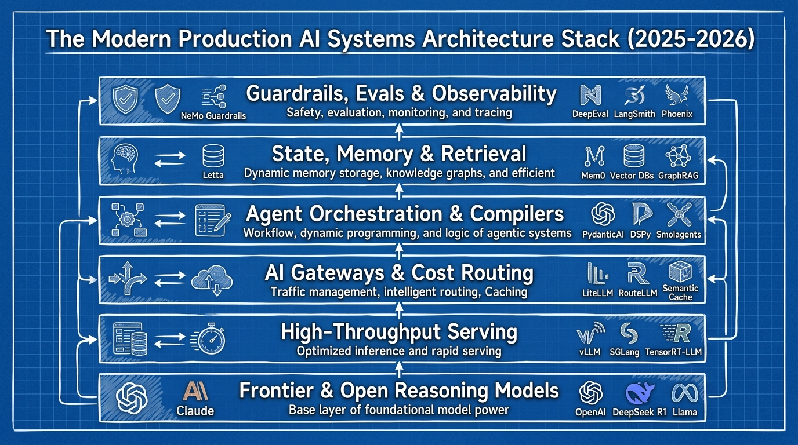
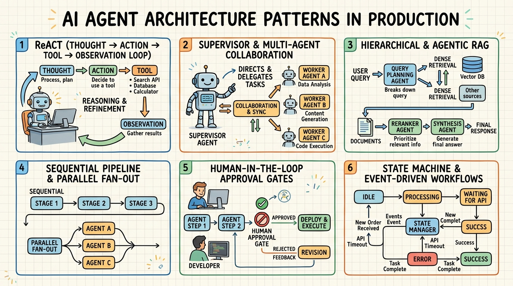

# Awesome AI Engineer [](https://awesome.re)

> A curated roadmap and resource collection for leveling up from **AI Engineer** to **AI Systems Architect** — with 18 production-ready portfolio projects, enterprise architecture patterns, and modern 2025–2026 LLM & agent engineering paradigms.

<p align="center">
  
</p>

<p align="center">
  <a href="#-career-roadmap">Roadmap</a> •
  <a href="#-portfolio-projects">Projects</a> •
  <a href="#-foundational-learning">Learning</a> •
  <a href="#-agent-frameworks--tools">Agent Frameworks</a> •
  <a href="#-structured-outputs--constrained-decoding">Structured Outputs</a> •
  <a href="#-reasoning-prompt-compilers--optimization">Reasoning & DSPy</a> •
  <a href="#-agent-memory--state-management">Memory & State</a> •
  <a href="#-ai-gateways-routing--cost-optimization">AI Gateways</a> •
  <a href="#%EF%B8%8F-mlops-serving--infrastructure">MLOps & Serving</a> •
  <a href="#-system-design-for-ai">System Design</a> •
  <a href="#%EF%B8%8F-runtime-guardrails--security">Guardrails</a> •
  <a href="#-realtime-voice--multimodal-systems">Realtime & Voice</a> •
  <a href="#-edge-ai--on-device-deployment">Edge AI</a> •
  <a href="#-books">Books</a> •
  <a href="#-contributing">Contributing</a>
</p>

---

## Why This List?

The AI engineering landscape is evolving fast. Beyond basic prompting and wrapper scripts, modern AI systems require rigorous architecture, stateful memory, constrained decoding, test-time compute, resilient gateways, and automated evaluation. This repo cuts through the noise with:

- **A clear career progression** from junior AI engineer to enterprise systems architect
- **18 hands-on portfolio projects** covering LLMs, multi-agent systems, RAG, gateways, and protocols
- **Curated 2025–2026 production stack** — structured outputs, prompt compilers, reasoning models, and realtime agents
- **Enterprise architecture focus** — production patterns, latency/cost routing, and safety guardrails

---

## 🗺️ Career Roadmap

<p align="center">
  
</p>

<details>
<summary><b>📖 Click to view Text & Level-by-Level Breakdown</b></summary>
<br>
┌─────────────────────────────────────────────────────────────────────┐
│                    AI ENGINEER → SYSTEMS ARCHITECT                  │
├─────────────────────────────────────────────────────────────────────┤
│                                                                     │
│  LEVEL 1: AI Engineer                                               │
│  ├── LLM fundamentals (tokenization, generation, fine-tuning)       │
│  ├── Prompt engineering, structured outputs & JSON schemas          │
│  ├── RAG pipelines, dense retrieval & vector databases              │
│  ├── API design for AI services & streaming (SSE/WebSockets)        │
│  └── Projects: #1 #2 #5 #7                                         │
│                                                                     │
│  LEVEL 2: Senior AI Engineer                                        │
│  ├── Agent architectures (ReAct, Plan-and-Execute, Code Agents)     │
│  ├── Multi-agent orchestration patterns (Supervisor, Hierarchical)  │
│  ├── Agentic frameworks (LangGraph, CrewAI, PydanticAI, ADK)        │
│  ├── Prompt optimization & compilers (DSPy, TextGrad)               │
│  ├── Streaming voice & real-time AI systems                         │
│  └── Projects: #3 #4 #6 #8                                         │
│                                                                     │
│  LEVEL 3: AI Platform Engineer                                      │
│  ├── MLOps & high-throughput serving (vLLM, SGLang, TensorRT-LLM)  │
│  ├── AI Gateways & smart routing (LiteLLM, RouteLLM, Portkey)       │
│  ├── Agent memory systems & persistent state (Letta, Mem0, Zep)     │
│  ├── Kubernetes for AI workloads & GPU orchestration                │
│  ├── Observability, tracing & evaluation (LangSmith, Phoenix)       │
│  ├── Protocol design & tool standards (MCP, A2A, UCP)               │
│  └── Projects: #9 #10 #11 #12 #13                                   │
│                                                                     │
│  LEVEL 4: AI Systems Architect                                      │
│  ├── Enterprise multi-agent system design at scale                  │
│  ├── Reasoning models, test-time compute & inference scaling        │
│  ├── Context caching economics & KV-cache optimization              │
│  ├── Runtime guardrails, security & defense against injection       │
│  ├── Cross-framework interoperability & model cascading             │
│  └── Projects: #14 #15 #16 #17 #18                                  │
│                                                                     │
└─────────────────────────────────────────────────────────────────────┘
```
</details>

---

## 🚀 Portfolio Projects

18 production-ready projects covering foundational LLMs to enterprise-scale AI architecture, each equipped with Docker setup, automated tests, CI/CD, and Kubernetes manifests.

### Foundation & Agent Workflows (Level 1-2)

| # | Project | What You'll Build | Key Skills | Repo |
|---|---------|-------------------|------------|------|
| 1 | **LLM Playground** | Interactive tokenization & generation explorer | BPE tokenization, sampling strategies, temperature | [](https://github.com/Skopaq-AI/llm-playground) |
| 2 | **Customer Support Chatbot** | Production chatbot with fine-tuning & evaluation | LoRA/PEFT, prompt engineering, evaluation metrics | [](https://github.com/Skopaq-AI/customer-support-chatbot) |
| 3 | **Ask-the-Web Agent** | Perplexity-like search & synthesis agent | LangGraph, tool use, citation generation | [](https://github.com/Skopaq-AI/ask-the-web-agent) |
| 4 | **Deep Research** | Multi-strategy reasoning engine | Chain-of-Thought, Tree-of-Thought, inference scaling | [](https://github.com/Skopaq-AI/deep-research) |
| 5 | **Image Generation** | Multi-provider image service | Diffusion models, DALL-E, FLUX, Stable Diffusion | [](https://github.com/Skopaq-AI/image-generation) |
| 6 | **Capstone Multi-Agent** | Supervisor-pattern agent platform | Multi-agent orchestration, task decomposition | [](https://github.com/Skopaq-AI/capstone-multiagent) |
| 7 | **Agent RAG** | Hierarchical RAG system | Single/multi/hierarchical retrieval, query decomposition | [](https://github.com/Skopaq-AI/agent-rag) |
| 8 | **MCP & A2A** | Protocol implementation | MCP SDK, A2A protocol, AgentCards | [](https://github.com/Skopaq-AI/mcp-a2a) |

### Platform, Gateways & Realtime Streaming (Level 3)

| # | Project | What You'll Build | Key Skills | Repo |
|---|---------|-------------------|------------|------|
| 9 | **UCP Merchant Server** | Commerce protocol platform | Checkout state machine, AP2 verification, MCP bindings | [](https://github.com/Skopaq-AI/ucp-merchant-server) |
| 10 | **UCP Shopping Agent** | AI shopping assistant | Multi-merchant discovery, comparison, LangGraph | [](https://github.com/Skopaq-AI/ucp-shopping-agent) |
| 11 | **Enterprise AI Gateway** | Resilient multi-provider routing gateway | LiteLLM, RouteLLM, semantic caching, rate limiting | [](https://github.com/Skopaq-AI/enterprise-ai-gateway) |
| 12 | **Realtime Voice Agent** | Sub-second bidirectional voice & multimodal agent | WebRTC / WebSockets, streaming STT/TTS, tool interrupts | [](https://github.com/Skopaq-AI/realtime-voice-agent) |
| 13 | **Stateful Memory Agent** | Tiered memory agent with entity knowledge graph | Letta/Mem0 paradigms, episodic recall, semantic store | [](https://github.com/Skopaq-AI/stateful-memory-agent) |

### Enterprise Systems, Compilers & Governance (Level 4)

| # | Project | What You'll Build | Key Skills | Repo |
|---|---------|-------------------|------------|------|
| 14 | **DSPy Prompt Optimizer** | Self-improving declarative prompt compiler | DSPy MIPROv2, teleprompters, metric optimization | [](https://github.com/Skopaq-AI/dspy-prompt-optimizer) |
| 15 | **AI Guardrails Firewall** | Zero-trust GenAI security & injection defense | NeMo Guardrails, Llama Guard 3, PII redaction | [](https://github.com/Skopaq-AI/ai-guardrails-firewall) |
| 16 | **Compliance Audit Agents** | Regulatory compliance audit system | Microsoft Agent Framework, graph workflows, middleware | [](https://github.com/Skopaq-AI/compliance-audit-agents) |
| 17 | **Incident Response ADK** | IT incident orchestrator | Google ADK / Genkit, Sequential/Parallel/Loop agents | [](https://github.com/Skopaq-AI/incident-response-adk) |
| 18 | **Contract Lifecycle Crew** | Contract management platform | CrewAI, role-based agents, Flow orchestration | [](https://github.com/Skopaq-AI/contract-lifecycle-crew) |

### Quick Start (Any Project)

```bash
# Clone any project repository
git clone https://github.com/Skopaq-AI/<project-name>.git
cd <project-name>

# Option 1: Docker (recommended)
docker compose up --build

# Option 2: Local development
pip install -e ".[dev]"
uvicorn src.<package>.main:app --reload --port 8000

# Run test suite
pytest tests/ -v
```

---

## 📚 Foundational Learning

### Courses & Tutorials

| Resource | Description | Level |
|----------|-------------|-------|
| [Neural Networks: Zero to Hero](https://karpathy.ai/zero-to-hero.html) | Andrej Karpathy's legendary series — build GPT from scratch | Beginner → Intermediate |
| [fast.ai Practical Deep Learning](https://course.fast.ai/) | Top-down practical approach to deep learning | Beginner |
| [Stanford CS224N: NLP with Deep Learning](https://web.stanford.edu/class/cs224n/) | Comprehensive NLP & transformer theory | Intermediate |
| [Stanford CS229: Machine Learning](https://cs229.stanford.edu/) | Andrew Ng's foundational ML course | Beginner → Intermediate |
| [DeepLearning.AI Short Courses](https://www.deeplearning.ai/short-courses/) | Bite-sized courses on LangChain, RAG, fine-tuning, agents | All levels |
| [Hugging Face NLP Course](https://huggingface.co/learn/nlp-course) | Hands-on transformers & NLP with the HF ecosystem | Beginner → Intermediate |
| [Full Stack LLM Bootcamp](https://fullstackdeeplearning.com/llm-bootcamp/) | Production LLM application development | Intermediate |
| [LLM University by Cohere](https://cohere.com/llmu) | Comprehensive LLM concepts and applications | Beginner → Intermediate |

### Prompt Engineering & Optimization

| Resource | Description |
|----------|-------------|
| [Anthropic Prompt Engineering Guide](https://docs.anthropic.com/en/docs/build-with-claude/prompt-engineering/overview) | Official Claude prompt engineering best practices & context caching |
| [OpenAI Prompt Engineering Guide](https://platform.openai.com/docs/guides/prompt-engineering) | Official GPT prompt engineering techniques & structured outputs |
| [Prompt Engineering Guide](https://www.promptingguide.ai/) | Community-driven comprehensive guide to prompting techniques |
| [DAIR.AI Prompt Engineering](https://github.com/dair-ai/Prompt-Engineering-Guide) | Research-backed prompting patterns, few-shot, and reasoning traces |

---

## 🤖 Agent Frameworks & Tools

### Core Frameworks

| Framework | Best For | Maintainer | Link |
|-----------|----------|------------|------|
| **LangGraph** | Complex stateful agent workflows with cycles and persistence | LangChain | [Docs](https://langchain-ai.github.io/langgraph/) |
| **PydanticAI** | Type-safe, production-grade agent framework built on Pydantic | Pydantic | [Docs](https://ai.pydantic.dev/) |
| **CrewAI** | Role-based multi-agent collaboration and hierarchical flows | CrewAI | [Docs](https://docs.crewai.com/) |
| **Smolagents** | Lightweight code-agent framework running secure sandboxed Python | Hugging Face | [GitHub](https://github.com/huggingface/smolagents) |
| **Google Genkit / ADK** | Agent Development Kit with enterprise workflows and Firebase integration | Google | [Docs](https://firebase.google.com/docs/genkit) |
| **Microsoft Agent Framework** | Enterprise agents with middleware pipelines and Azure integration | Microsoft | [GitHub](https://github.com/microsoft/agents) |
| **OpenAI Agents SDK** | Lightweight agent loops with multi-agent handoffs | OpenAI | [Docs](https://openai.github.io/openai-agents-python/) |
| **LlamaIndex** | Data-centric RAG and document-native agent workflows | LlamaIndex | [Docs](https://docs.llamaindex.ai/) |
| **AutoGen** | Event-driven multi-agent conversation patterns | Microsoft | [Docs](https://microsoft.github.io/autogen/) |
| **Semantic Kernel** | Enterprise AI orchestration for .NET, Python, and Java | Microsoft | [Docs](https://learn.microsoft.com/semantic-kernel/) |

### Agent Protocols & Standards

| Protocol | Purpose | Link |
|----------|---------|------|
| **MCP (Model Context Protocol)** | Standardized protocol for connecting AI models to tools and resources | [Spec](https://modelcontextprotocol.io/) |
| **A2A (Agent-to-Agent)** | Standardized inter-agent communication protocol | [Spec](https://google.github.io/A2A/) |
| **UCP (Universal Commerce Protocol)** | Secure agentic commerce and checkout transaction standard | [Spec](https://github.com/anthropics/ucp) |
| **OpenAI Function Calling** | Structured tool use standard adopted across major providers | [Docs](https://platform.openai.com/docs/guides/function-calling) |

### Observability & Tracing

| Tool | Purpose | Link |
|------|---------|------|
| **LangSmith** | LLM observability, step-level tracing, and dataset evaluations | [Docs](https://docs.smith.langchain.com/) |
| **Arize Phoenix** | Open-source AI observability, evals, and OpenTelemetry tracing | [GitHub](https://github.com/Arize-AI/phoenix) |
| **Weights & Biases Weave** | Lightweight AI application tracing, scoring, and evaluation | [Docs](https://wandb.ai/site/weave) |
| **Braintrust** | Enterprise evaluation platform, logging proxy, and prompt playground | [Docs](https://www.braintrust.dev/) |
| **OpenLLMetry** | OpenTelemetry-based instrumentation for LLM applications | [GitHub](https://github.com/traceloop/openllmetry) |

---

## 📐 Structured Outputs & Constrained Decoding

Deterministic schema enforcement is essential for production agents, APIs, and data extraction pipelines.

| Tool | Purpose | Link |
|------|---------|------|
| **Instructor** | Structured outputs for LLMs via Pydantic — validation, retries, and streaming | [Docs](https://python.useinstructor.com/) |
| **Outlines** | Fast, guided text generation enforcing regex and JSON schemas via CFGs | [GitHub](https://github.com/dottxt-ai/outlines) |
| **Guidance** | Constrained decoding language controlling generation structure and interleaving | [GitHub](https://github.com/guidance-ai/guidance) |
| **TypeChat** | Schema-guided structured output generation using TypeScript definitions | [GitHub](https://github.com/microsoft/TypeChat) |
| **Jsonformer** | Bulletproof JSON generation generating only schema-fill tokens | [GitHub](https://github.com/1rgs/jsonformer) |

---

## 🧠 Reasoning, Prompt Compilers & Optimization

Modern AI engineering compiles prompts programmatically and leverages test-time search.

| Tool / Concept | Purpose | Link |
|----------------|---------|------|
| **DSPy** | Stanford framework for compiling declarative pipelines into optimized prompts & weights | [Docs](https://dspy.ai/) |
| **TextGrad** | Automatic "differentiation" via text feedback for prompt and system optimization | [GitHub](https://github.com/zou-group/textgrad) |
| **DeepSeek-R1** | Open reasoning models demonstrating reinforcement learning test-time scaling | [GitHub](https://github.com/deepseek-ai/DeepSeek-R1) |
| **Process Reward Models (PRMs)** | Step-by-step verification and tree-search scoring for complex problem solving | [Paper](https://arxiv.org/abs/2305.20050) |
| **Tree-of-Thought (ToT)** | Deliberate exploration and heuristic evaluation of reasoning paths | [GitHub](https://github.com/princeton-nlp/tree-of-thought-llm) |

---

## 💾 Agent Memory & State Management

Stateful agents require distinct memory layers: short-term context, working memory, episodic memory, and long-term semantic memory.

| Tool | Purpose | Link |
|------|---------|------|
| **Letta (formerly MemGPT)** | Stateful agent platform managing working memory and archival storage | [GitHub](https://github.com/letta-ai/letta) |
| **Mem0** | Personalized memory layer for AI agents, extracting entity and user preferences | [GitHub](https://github.com/mem0ai/mem0) |
| **Zep** | Long-term memory server providing auto-summarization and knowledge graphs | [Docs](https://help.getzep.com/) |
| **LangGraph Store** | Built-in key-value and semantic cross-thread persistence for stateful agents | [Docs](https://langchain-ai.github.io/langgraph/concepts/persistence/) |

---

## 🌐 AI Gateways, Routing & Cost Optimization

Production AI architectures implement unified gateways for rate-limiting, failover, prompt caching, and cost-aware routing.

| Tool | Purpose | Link |
|------|---------|------|
| **LiteLLM** | Unified proxy for 100+ LLMs with load balancing, retries, and spend tracking | [GitHub](https://github.com/BerriAI/litellm) |
| **RouteLLM** | Framework for serving and evaluating cost-effective LLM routing | [GitHub](https://github.com/lm-sys/RouteLLM) |
| **Portkey Gateway** | Blazing fast AI gateway with 50+ integrations, semantic cache, and fallbacks | [GitHub](https://github.com/Portkey-AI/gateway) |
| **OpenRouter** | Multi-provider unified routing and competitive pricing API | [Site](https://openrouter.ai/) |
| **Helicone** | Developer observability proxy for caching, rate limiting, and cost analytics | [Docs](https://docs.helicone.ai/) |

---

## ⚙️ MLOps, Serving & Infrastructure

<p align="center">
  
</p>

### High-Throughput Model Serving

| Tool | Purpose | Link |
|------|---------|------|
| **vLLM** | High-throughput LLM serving with PagedAttention and prefix caching | [GitHub](https://github.com/vllm-project/vllm) |
| **SGLang** | High-performance serving engine for LLMs/VLMs with RadixAttention | [GitHub](https://github.com/sgl-project/sglang) |
| **TensorRT-LLM** | NVIDIA-optimized LLM inference execution engine | [GitHub](https://github.com/NVIDIA/TensorRT-LLM) |
| **Triton Inference Server** | Multi-framework production model serving at scale | [GitHub](https://github.com/triton-inference-server/server) |
| **Ollama** | Lightweight CLI to run open-source models locally with one command | [GitHub](https://github.com/ollama/ollama) |
| **llama.cpp** | Ultra-efficient CPU/GPU LLM inference in C/C++ | [GitHub](https://github.com/ggerganov/llama.cpp) |

### Vector Databases & Retrieval Engines

| Database | Strengths | Link |
|----------|-----------|------|
| **Qdrant** | Rust-based vector search engine with payload filtering and quantization | [Docs](https://qdrant.tech/) |
| **Pinecone** | Serverless managed vector database with hybrid search | [Docs](https://www.pinecone.io/) |
| **Weaviate** | Open-source vector database with multi-modal capabilities and hybrid search | [Docs](https://weaviate.io/) |
| **pgvector** | PostgreSQL extension enabling vector embeddings in relational DBs | [GitHub](https://github.com/pgvector/pgvector) |
| **Milvus** | Distributed, highly scalable vector database for billion-scale search | [Docs](https://milvus.io/) |
| **ChromaDB** | Lightweight, open-source embedding database for rapid prototyping | [Docs](https://www.trychroma.com/) |

### Fine-Tuning & Training

| Tool | Purpose | Link |
|------|---------|------|
| **Unsloth** | 2-5x faster LLM fine-tuning with 80% less VRAM | [GitHub](https://github.com/unslothai/unsloth) |
| **Hugging Face TRL** | Transformer Reinforcement Learning (DPO, ORPO, GRPO, SFT) | [Docs](https://huggingface.co/docs/trl/) |
| **Axolotl** | Production-ready LLM fine-tuning configured through YAML | [GitHub](https://github.com/axolotl-ai-cloud/axolotl) |
| **PEFT** | Parameter-efficient fine-tuning (LoRA, QLoRA, Prompt Tuning) | [Docs](https://huggingface.co/docs/peft/) |
| **LitGPT** | Hackable 20+ LLM pretraining and fine-tuning engine by Lightning AI | [GitHub](https://github.com/Lightning-AI/litgpt) |

---

## 🏗️ System Design for AI

### Architecture Patterns

<p align="center">
  
</p>

| Pattern | When to Use | Reference / Project Example |
|---------|-------------|-----------------------------|
| **Agentic RAG** | Dynamic multi-step retrieval, query routing & self-correction | [Agent RAG (#7)](https://github.com/samuelvinay91/agent-rag) |
| **GraphRAG** | Complex entity-relationship reasoning across document corpora | [Microsoft GraphRAG](https://github.com/microsoft/graphrag) |
| **ReAct (Reason + Act)** | Interleaving thought steps with tool invocations | [Ask-the-Web (#3)](https://github.com/samuelvinay91/ask-the-web-agent) |
| **Supervisor Pattern** | Central orchestrator routing sub-tasks to specialized domain agents | [Capstone (#6)](https://github.com/samuelvinay91/capstone-multiagent) |
| **Prompt Caching** | Long-context apps to reduce latency and API costs by up to 90% | [Anthropic Prompt Caching](https://docs.anthropic.com/en/docs/build-with-claude/prompt-caching) |
| **Sequential Pipeline** | Deterministic ordered multi-step processing | [Incident Response (#12)](https://github.com/samuelvinay91/incident-response-adk) |
| **Parallel Fan-Out** | Concurrent independent agent executions | [Incident Response (#12)](https://github.com/samuelvinay91/incident-response-adk) |
| **Human-in-the-Loop** | Approval gates, validation interrupts & escalation | [Compliance Audit (#11)](https://github.com/samuelvinay91/compliance-audit-agents) |
| **Model Cascading** | Routing simple queries to SLMs and complex reasoning to frontier models | [RouteLLM](https://github.com/lm-sys/RouteLLM) |
| **State Machine** | Transactional, verifiable multi-step commerce workflows | [UCP Merchant (#9)](https://github.com/samuelvinay91/ucp-merchant-server) |

### Evaluation & Testing

| Tool | Purpose | Link |
|------|---------|------|
| **RAGAS** | Automated evaluation framework for RAG pipelines (faithfulness, answer relevancy) | [Docs](https://docs.ragas.io/) |
| **DeepEval** | Unit testing framework for LLMs with 14+ production metrics | [GitHub](https://github.com/confident-ai/deepeval) |
| **Promptfoo** | Automated testing, red-teaming, and regression testing for prompts | [Docs](https://www.promptfoo.dev/) |
| **Inspect AI** | Framework for large language model evaluations and safety benchmarks by AISI | [GitHub](https://github.com/UKGovernmentBEIS/inspect_ai) |

---

## 🛡️ Runtime Guardrails & Security

| Tool / Framework | Purpose | Link |
|------------------|---------|------|
| **NeMo Guardrails** | Programmable rails for dialogue safety, topical control, and hallucination reduction | [GitHub](https://github.com/NVIDIA/NeMo-Guardrails) |
| **Guardrails AI** | Real-time output validation, structured assertions, and schema correction | [GitHub](https://github.com/guardrails-ai/guardrails) |
| **Llama Guard** | Fine-tuned safeguard model for input/output safety classification by Meta | [Docs](https://llama.meta.com/docs/model-cards-and-prompt-formats/llama-guard-3/) |
| **Lakera AI** | Real-time defense against prompt injection, jailbreaking, and data leakage | [Site](https://www.lakera.ai/) |
| **Garak** | LLM vulnerability scanner identifying hallucination, injection, and security flaws | [GitHub](https://github.com/leondz/garak) |
| **OWASP Top 10 for LLMs** | Standardized threat model for generative AI and LLM application security | [Docs](https://genai.owasp.org/) |

---

## 🎙️ Realtime Voice & Multimodal Systems

| Tool / Standard | Purpose | Link |
|-----------------|---------|------|
| **LiveKit Agents** | Realtime voice, video, and multimodal agent framework with WebRTC | [Docs](https://docs.livekit.io/agents/) |
| **OpenAI Realtime API** | Low-latency, speech-to-speech bidirectional streaming over WebSockets | [Docs](https://platform.openai.com/docs/guides/realtime) |
| **Faster-Whisper** | Reimplementation of OpenAI's Whisper model using CTranslate2 for ultra-fast transcription | [GitHub](https://github.com/SYSTRAN/faster-whisper) |
| **ColPali** | Efficient vision-language retrieval model indexing documents as images | [GitHub](https://github.com/illuin-tech/colpali) |

---

## 📱 Edge AI & On-Device Deployment

| Tool / Framework | Target | Link |
|------------------|--------|------|
| **Apple MLX** | Optimized machine learning framework designed for Apple Silicon GPUs/Unified Memory | [GitHub](https://github.com/ml-explore/mlx) |
| **ExecuTorch** | PyTorch end-to-end solution for on-device inference on mobile and edge devices | [GitHub](https://github.com/pytorch/executorch) |
| **ONNX Runtime** | Cross-platform accelerator for high-performance ML inference on edge and cloud | [Site](https://onnxruntime.ai/) |
| **Transformers.js** | Run state-of-the-art transformer models directly in browsers and Node.js via WebGPU | [GitHub](https://github.com/huggingface/transformers.js) |

---

## ☁️ Cloud & Kubernetes for AI

### Cloud AI Platforms

| Provider | Key Services | Link |
|----------|-------------|------|
| **Google Cloud** | Vertex AI, Gemini APIs, Cloud TPUs, GKE Enterprise for AI | [Docs](https://cloud.google.com/vertex-ai) |
| **AWS** | Amazon Bedrock, SageMaker HyperPod, Trainium/Inferentia accelerators | [Docs](https://aws.amazon.com/machine-learning/) |
| **Azure** | Azure OpenAI Service, Azure AI Foundry, AKS with GPU operators | [Docs](https://azure.microsoft.com/en-us/products/ai-services/) |

### Kubernetes for AI Workloads

| Resource | Description | Link |
|----------|-------------|------|
| **KServe** | Serverless model serving standard on Kubernetes | [Docs](https://kserve.github.io/website/) |
| **KubeFlow** | Cloud-native end-to-end ML platform on Kubernetes | [Docs](https://www.kubeflow.org/) |
| **Ray on Kubernetes (KubeRay)** | Distributed ML compute and batch training on K8s | [Docs](https://docs.ray.io/en/latest/cluster/kubernetes/) |
| **NVIDIA GPU Operator** | Automated GPU driver, container runtime, and telemetry management in K8s | [Docs](https://docs.nvidia.com/datacenter/cloud-native/gpu-operator/) |

---

## 📖 Books

### Essential Reading

| Book | Author | Why It Matters |
|------|--------|----------------|
| **AI Engineering** | Chip Huyen | Definitive guide to building reliable LLM applications in production |
| **Designing Machine Learning Systems** | Chip Huyen | System design fundamentals from data pipelines to model serving |
| **Build a Large Language Model (From Scratch)** | Sebastian Raschka | Deep understanding of transformer internals and tokenizers |
| **Hands-On Large Language Models** | Jay Alammar, Maarten Grootendorst | Visual, practical patterns for modern LLM applications |
| **Designing Data-Intensive Applications** | Martin Kleppmann | Foundational data architecture principles essential for AI systems architects |

---

## 📰 Blogs, Podcasts & Newsletters

| Resource | Type | Focus | Link |
|----------|------|-------|------|
| **AI Weekly** | Newsletter | Models, agents, research, and policy ranked from expert signals | [Subscribe](https://aiweekly.co/) |
| **Lil'Log** | Blog | Deep technical surveys on LLMs and generative models by Lilian Weng | [Blog](https://lilianweng.github.io/) |
| **Eugene Yan** | Blog | Applied ML systems design, search, and production patterns | [Blog](https://eugeneyan.com/) |
| **Latent Space** | Podcast / Newsletter | The leading technical podcast and community for AI engineers | [Listen](https://www.latent.space/) |
| **The Batch** | Newsletter | Weekly AI news and insights curated by Andrew Ng | [Subscribe](https://www.deeplearning.ai/the-batch/) |
| **Interconnects** | Newsletter | Nathan Lambert on RLHF, open models, and reasoning architectures | [Subscribe](https://www.interconnects.ai/) |

---

## 🤝 Contributing

Contributions are welcome! Please check out [CONTRIBUTING.md](CONTRIBUTING.md) for contribution guidelines, table schema formats, and PR rules.

---

## 📊 Star History

[](https://star-history.com/#Skopaq-AI/awesome-ai-engineer&Date)

---

## License

[](https://creativecommons.org/publicdomain/zero/1.0/)

This work is licensed under [CC0 1.0 Universal](LICENSE).
