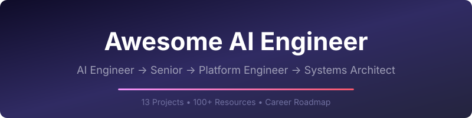

# Awesome AI Engineer [](https://awesome.re)

> A curated roadmap and resource collection for leveling up from **AI Engineer** to **AI Systems Architect** — with 13 production-ready portfolio projects to build along the way.

<p align="center">
  
</p>

<p align="center">
  <a href="#-career-roadmap">Roadmap</a> •
  <a href="#-portfolio-projects">Projects</a> •
  <a href="#-foundational-learning">Learning</a> •
  <a href="#-agent-frameworks--tools">Frameworks</a> •
  <a href="#%EF%B8%8F-mlops--infrastructure">MLOps</a> •
  <a href="#-system-design-for-ai">System Design</a> •
  <a href="#-books">Books</a> •
  <a href="#-contributing">Contributing</a>
</p>

---

## Why This List?

The AI engineering landscape is evolving fast. New frameworks, models, and patterns emerge weekly. This repo cuts through the noise with:

- **A clear career progression** from junior AI engineer to systems architect
- **13 hands-on projects** covering LLMs, agents, RAG, multi-agent systems, and protocols
- **Curated resources** — only the best, most relevant material for 2025-2026
- **Enterprise focus** — production patterns, not just tutorials

---

## 🗺️ Career Roadmap

```
┌─────────────────────────────────────────────────────────────────────┐
│                    AI ENGINEER → SYSTEMS ARCHITECT                  │
├─────────────────────────────────────────────────────────────────────┤
│                                                                     │
│  LEVEL 1: AI Engineer                                               │
│  ├── LLM fundamentals (tokenization, generation, fine-tuning)       │
│  ├── Prompt engineering & evaluation                                │
│  ├── RAG pipelines & vector databases                               │
│  ├── API design for AI services                                     │
│  └── Projects: #1 #2 #5 #7                                         │
│                                                                     │
│  LEVEL 2: Senior AI Engineer                                        │
│  ├── Agent architectures (ReAct, Plan-and-Execute)                  │
│  ├── Multi-agent orchestration patterns                             │
│  ├── Agentic frameworks (LangGraph, CrewAI, ADK)                    │
│  ├── Streaming & real-time AI systems                               │
│  └── Projects: #3 #4 #6 #8                                         │
│                                                                     │
│  LEVEL 3: AI Platform Engineer                                      │
│  ├── MLOps & model serving (vLLM, TensorRT, Triton)                │
│  ├── Kubernetes for AI workloads                                    │
│  ├── Observability & evaluation frameworks                          │
│  ├── Protocol design (MCP, A2A, UCP)                                │
│  └── Projects: #8 #9 #10                                           │
│                                                                     │
│  LEVEL 4: AI Systems Architect                                      │
│  ├── Enterprise agent framework patterns                            │
│  ├── Multi-agent system design at scale                             │
│  ├── Compliance, security & governance for AI                       │
│  ├── Cross-framework interoperability                               │
│  └── Projects: #11 #12 #13                                         │
│                                                                     │
└─────────────────────────────────────────────────────────────────────┘
```

---

## 🚀 Portfolio Projects

13 production-ready projects, each in its own repo with Docker setup, tests, CI/CD, and Kubernetes manifests. Clone any project and run it in under 2 minutes.

### Foundation (Level 1-2)

| # | Project | What You'll Build | Key Skills | Repo |
|---|---------|-------------------|------------|------|
| 1 | **LLM Playground** | Interactive tokenization & generation explorer | BPE tokenization, sampling strategies, temperature | [](https://github.com/samuelvinay91/llm-playground) |
| 2 | **Customer Support Chatbot** | Production chatbot with fine-tuning | LoRA/PEFT, prompt engineering, evaluation | [](https://github.com/samuelvinay91/customer-support-chatbot) |
| 3 | **Ask-the-Web Agent** | Perplexity-like search & synthesis agent | LangGraph, tool use, citation generation | [](https://github.com/samuelvinay91/ask-the-web-agent) |
| 4 | **Deep Research** | Multi-strategy reasoning engine | Chain-of-Thought, Tree-of-Thought, inference scaling | [](https://github.com/samuelvinay91/deep-research) |
| 5 | **Image Generation** | Multi-provider image service | Diffusion models, DALL-E, FLUX, Stable Diffusion | [](https://github.com/samuelvinay91/image-generation) |
| 6 | **Capstone Multi-Agent** | Supervisor-pattern agent platform | Multi-agent orchestration, task decomposition | [](https://github.com/samuelvinay91/capstone-multiagent) |
| 7 | **Agent RAG** | Hierarchical RAG system | Single/multi/hierarchical retrieval, query decomposition | [](https://github.com/samuelvinay91/agent-rag) |
| 8 | **MCP & A2A** | Protocol implementation | MCP SDK, A2A protocol, AgentCards | [](https://github.com/samuelvinay91/mcp-a2a) |

### Protocol & Commerce (Level 3)

| # | Project | What You'll Build | Key Skills | Repo |
|---|---------|-------------------|------------|------|
| 9 | **UCP Merchant Server** | Commerce protocol platform | Checkout state machine, AP2 verification, MCP bindings | [](https://github.com/samuelvinay91/ucp-merchant-server) |
| 10 | **UCP Shopping Agent** | AI shopping assistant | Multi-merchant discovery, comparison, LangGraph | [](https://github.com/samuelvinay91/ucp-shopping-agent) |

### Enterprise Frameworks (Level 4)

| # | Project | What You'll Build | Key Skills | Repo |
|---|---------|-------------------|------------|------|
| 11 | **Compliance Audit Agents** | Regulatory compliance system | Microsoft Agent Framework, graph workflows, middleware | [](https://github.com/samuelvinay91/compliance-audit-agents) |
| 12 | **Incident Response ADK** | IT incident orchestrator | Google ADK, Sequential/Parallel/Loop agents | [](https://github.com/samuelvinay91/incident-response-adk) |
| 13 | **Contract Lifecycle Crew** | Contract management platform | CrewAI, role-based agents, Flow orchestration | [](https://github.com/samuelvinay91/contract-lifecycle-crew) |

### Quick Start (Any Project)

```bash
# Clone any project
git clone https://github.com/samuelvinay91/<project-name>.git
cd <project-name>

# Option 1: Docker (recommended)
docker compose up --build

# Option 2: Local
pip install -e ".[dev]"
uvicorn src.<package>.main:app --reload --port <port>

# Run tests
pytest tests/ -v
```

---

## 📚 Foundational Learning

### Courses & Tutorials

| Resource | Description | Level |
|----------|-------------|-------|
| [Neural Networks: Zero to Hero](https://karpathy.ai/zero-to-hero.html) | Andrej Karpathy's legendary series — build GPT from scratch | Beginner → Intermediate |
| [fast.ai Practical Deep Learning](https://course.fast.ai/) | Top-down practical approach to deep learning | Beginner |
| [Stanford CS224N: NLP with Deep Learning](https://web.stanford.edu/class/cs224n/) | Comprehensive NLP & transformer theory | Intermediate |
| [Stanford CS229: Machine Learning](https://cs229.stanford.edu/) | Andrew Ng's foundational ML course | Beginner → Intermediate |
| [DeepLearning.AI Short Courses](https://www.deeplearning.ai/short-courses/) | Bite-sized courses on LangChain, RAG, fine-tuning, agents | All levels |
| [Hugging Face NLP Course](https://huggingface.co/learn/nlp-course) | Hands-on transformers & NLP with the HF ecosystem | Beginner → Intermediate |
| [Full Stack LLM Bootcamp](https://fullstackdeeplearning.com/llm-bootcamp/) | Production LLM application development | Intermediate |
| [LLM University by Cohere](https://cohere.com/llmu) | Comprehensive LLM concepts and applications | Beginner → Intermediate |

### Prompt Engineering

| Resource | Description |
|----------|-------------|
| [Anthropic Prompt Engineering Guide](https://docs.anthropic.com/en/docs/build-with-claude/prompt-engineering/overview) | Official Claude prompt engineering best practices |
| [OpenAI Prompt Engineering Guide](https://platform.openai.com/docs/guides/prompt-engineering) | Official GPT prompt engineering techniques |
| [Prompt Engineering Guide](https://www.promptingguide.ai/) | Community-driven comprehensive guide to prompting techniques |
| [DAIR.AI Prompt Engineering](https://github.com/dair-ai/Prompt-Engineering-Guide) | Research-backed prompting patterns and techniques |

---

## 🤖 Agent Frameworks & Tools

### Core Frameworks

| Framework | Best For | Maintainer | Link |
|-----------|----------|------------|------|
| **LangGraph** | Complex stateful agent workflows with cycles | LangChain | [Docs](https://langchain-ai.github.io/langgraph/) |
| **CrewAI** | Role-based multi-agent collaboration | CrewAI | [Docs](https://docs.crewai.com/) |
| **Google ADK** | Agent Development Kit with sequential/parallel patterns | Google | [Docs](https://google.github.io/adk-docs/) |
| **Microsoft Agent Framework** | Enterprise agents with middleware pipelines | Microsoft | [GitHub](https://github.com/microsoft/agents) |
| **OpenAI Agents SDK** | Simple agent loops with handoffs | OpenAI | [Docs](https://openai.github.io/openai-agents-python/) |
| **LlamaIndex** | Data-centric RAG and agent workflows | LlamaIndex | [Docs](https://docs.llamaindex.ai/) |
| **AutoGen** | Multi-agent conversation patterns | Microsoft | [Docs](https://microsoft.github.io/autogen/) |
| **Semantic Kernel** | Enterprise AI orchestration for .NET/Python/Java | Microsoft | [Docs](https://learn.microsoft.com/semantic-kernel/) |

### Agent Protocols & Standards

| Protocol | Purpose | Link |
|----------|---------|------|
| **MCP (Model Context Protocol)** | Standardized tool/resource access for LLMs | [Spec](https://modelcontextprotocol.io/) |
| **A2A (Agent-to-Agent)** | Inter-agent communication protocol by Google | [Spec](https://google.github.io/A2A/) |
| **UCP (Universal Commerce Protocol)** | Agentic commerce transactions | [Spec](https://github.com/anthropics/ucp) |
| **OpenAI Function Calling** | Structured tool use for LLMs | [Docs](https://platform.openai.com/docs/guides/function-calling) |

### Orchestration & Deployment

| Tool | Purpose | Link |
|------|---------|------|
| **LangSmith** | LLM observability, tracing, and evaluation | [Docs](https://docs.smith.langchain.com/) |
| **Weights & Biases Weave** | AI application tracing and evaluation | [Docs](https://wandb.ai/site/weave) |
| **Arize Phoenix** | Open-source LLM observability | [GitHub](https://github.com/Arize-AI/phoenix) |
| **Braintrust** | Eval, logging, and prompt playground | [Docs](https://www.braintrust.dev/) |

---

## ⚙️ MLOps & Infrastructure

### Model Serving

| Tool | Purpose | Link |
|------|---------|------|
| **vLLM** | High-throughput LLM serving with PagedAttention | [GitHub](https://github.com/vllm-project/vllm) |
| **TensorRT-LLM** | NVIDIA optimized LLM inference | [GitHub](https://github.com/NVIDIA/TensorRT-LLM) |
| **Triton Inference Server** | Multi-framework model serving at scale | [GitHub](https://github.com/triton-inference-server/server) |
| **Ollama** | Run LLMs locally with one command | [GitHub](https://github.com/ollama/ollama) |
| **llama.cpp** | CPU/GPU inference for LLMs in C++ | [GitHub](https://github.com/ggerganov/llama.cpp) |
| **SGLang** | Fast serving framework for LLMs and VLMs | [GitHub](https://github.com/sgl-project/sglang) |

### ML Platforms & Experiment Tracking

| Tool | Purpose | Link |
|------|---------|------|
| **MLflow** | Experiment tracking, model registry, deployment | [Docs](https://mlflow.org/) |
| **Weights & Biases** | Experiment tracking, dataset versioning | [Docs](https://wandb.ai/) |
| **Ray** | Distributed compute for ML training and serving | [Docs](https://docs.ray.io/) |
| **DVC** | Data version control and ML pipelines | [Docs](https://dvc.org/) |
| **Kubeflow** | ML workflows on Kubernetes | [Docs](https://www.kubeflow.org/) |

### Vector Databases

| Database | Strengths | Link |
|----------|-----------|------|
| **Qdrant** | Rust-based, fast, rich filtering | [Docs](https://qdrant.tech/) |
| **Pinecone** | Fully managed, serverless option | [Docs](https://www.pinecone.io/) |
| **Weaviate** | Multi-modal, GraphQL API | [Docs](https://weaviate.io/) |
| **ChromaDB** | Simple, lightweight, great for prototyping | [Docs](https://www.trychroma.com/) |
| **Milvus** | Scalable, GPU-accelerated similarity search | [Docs](https://milvus.io/) |
| **pgvector** | PostgreSQL extension — use your existing DB | [GitHub](https://github.com/pgvector/pgvector) |

### Fine-Tuning & Training

| Tool | Purpose | Link |
|------|---------|------|
| **Hugging Face TRL** | RLHF, DPO, SFT training | [Docs](https://huggingface.co/docs/trl/) |
| **Unsloth** | 2-5x faster fine-tuning with 80% less memory | [GitHub](https://github.com/unslothai/unsloth) |
| **Axolotl** | Streamlined fine-tuning with YAML configs | [GitHub](https://github.com/axolotl-ai-cloud/axolotl) |
| **PEFT** | Parameter-efficient fine-tuning (LoRA, QLoRA) | [Docs](https://huggingface.co/docs/peft/) |
| **LitGPT** | Pretrain, fine-tune, deploy LLMs | [GitHub](https://github.com/Lightning-AI/litgpt) |

---

## 🏗️ System Design for AI

### Architecture Patterns

| Pattern | When to Use | Project Example |
|---------|-------------|-----------------|
| **RAG (Retrieval-Augmented Generation)** | Ground LLM responses in external data | [Agent RAG (#7)](https://github.com/samuelvinay91/agent-rag) |
| **Agentic RAG** | Dynamic retrieval with query routing | [Agent RAG (#7)](https://github.com/samuelvinay91/agent-rag) |
| **ReAct (Reason + Act)** | Tool-using agents with reasoning traces | [Ask-the-Web (#3)](https://github.com/samuelvinay91/ask-the-web-agent) |
| **Supervisor Pattern** | Central agent delegates to specialists | [Capstone (#6)](https://github.com/samuelvinay91/capstone-multiagent) |
| **Sequential Pipeline** | Ordered multi-step processing | [Incident Response (#12)](https://github.com/samuelvinay91/incident-response-adk) |
| **Parallel Fan-Out** | Independent tasks run concurrently | [Incident Response (#12)](https://github.com/samuelvinay91/incident-response-adk) |
| **Human-in-the-Loop** | Approval gates for high-stakes decisions | [Compliance Audit (#11)](https://github.com/samuelvinay91/compliance-audit-agents) |
| **Event-Driven Flow** | Conditional routing based on intermediate results | [Contract Lifecycle (#13)](https://github.com/samuelvinay91/contract-lifecycle-crew) |
| **Middleware Pipeline** | Cross-cutting concerns (auth, logging, PII redaction) | [Compliance Audit (#11)](https://github.com/samuelvinay91/compliance-audit-agents) |
| **State Machine** | Complex multi-step transactions | [UCP Merchant (#9)](https://github.com/samuelvinay91/ucp-merchant-server) |

### System Design Resources

| Resource | Description | Link |
|----------|-------------|------|
| **Chip Huyen — AI Engineering** | Definitive guide to building AI applications | [Book](https://www.oreilly.com/library/view/ai-engineering/9781098166298/) |
| **Designing Machine Learning Systems** | ML system design end-to-end (Chip Huyen) | [Book](https://www.oreilly.com/library/view/designing-machine-learning/9781098107956/) |
| **Eugene Yan — Applied ML** | Practical patterns for production ML | [Blog](https://eugeneyan.com/) |
| **The AI Engineer's Handbook** | Architecture patterns for LLM applications | [Newsletter](https://www.aiengineer.com/) |
| **System Design for ML** | Interview prep meets real-world ML design | [GitHub](https://github.com/chiphuyen/machine-learning-systems-design) |

### Evaluation & Testing

| Tool | Purpose | Link |
|------|---------|------|
| **RAGAS** | RAG evaluation framework | [Docs](https://docs.ragas.io/) |
| **DeepEval** | LLM evaluation with 14+ metrics | [GitHub](https://github.com/confident-ai/deepeval) |
| **Promptfoo** | LLM output testing and red-teaming | [Docs](https://www.promptfoo.dev/) |
| **Inspect AI** | AI safety evaluations by AISI | [GitHub](https://github.com/UKGovernmentBEIS/inspect_ai) |
| **Giskard** | ML model testing and vulnerability scanning | [GitHub](https://github.com/Giskard-AI/giskard) |

---

## ☁️ Cloud & Kubernetes for AI

### Cloud AI Services

| Provider | Key Services | Link |
|----------|-------------|------|
| **AWS** | Bedrock (managed LLMs), SageMaker (training/serving), Inferentia | [Docs](https://aws.amazon.com/machine-learning/) |
| **Google Cloud** | Vertex AI, Gemini API, Cloud TPUs, GKE for ML | [Docs](https://cloud.google.com/vertex-ai) |
| **Azure** | Azure OpenAI Service, Azure ML, AKS for AI | [Docs](https://azure.microsoft.com/en-us/products/ai-services/) |

### Kubernetes for AI Workloads

| Resource | Description | Link |
|----------|-------------|------|
| **KubeFlow** | End-to-end ML platform on Kubernetes | [Docs](https://www.kubeflow.org/) |
| **KServe** | Standardized ML model serving on K8s | [Docs](https://kserve.github.io/website/) |
| **NVIDIA GPU Operator** | Automated GPU management in K8s | [Docs](https://docs.nvidia.com/datacenter/cloud-native/gpu-operator/) |
| **Ray on Kubernetes** | Distributed ML compute on K8s with KubeRay | [Docs](https://docs.ray.io/en/latest/cluster/kubernetes/) |
| **Kustomize** | Template-free K8s configuration management | [Docs](https://kustomize.io/) |

### Certifications

| Certification | Provider | Focus |
|---------------|----------|-------|
| [AWS Machine Learning Specialty](https://aws.amazon.com/certification/certified-machine-learning-specialty/) | AWS | ML on AWS — SageMaker, data engineering, modeling |
| [Google Professional ML Engineer](https://cloud.google.com/learn/certification/machine-learning-engineer) | GCP | ML systems design on Google Cloud |
| [Azure AI Engineer Associate](https://learn.microsoft.com/en-us/credentials/certifications/azure-ai-engineer/) | Azure | AI solution design on Azure |
| [Terraform Associate](https://www.hashicorp.com/certification/terraform-associate) | HashiCorp | Infrastructure as Code for AI infrastructure |
| [CKA (Certified Kubernetes Admin)](https://www.cncf.io/certification/cka/) | CNCF | Kubernetes administration for AI workloads |

---

## 📖 Books

### Must-Read

| Book | Author | Why It Matters |
|------|--------|----------------|
| **AI Engineering** | Chip Huyen | _The_ book for building LLM applications in production (2025) |
| **Designing Machine Learning Systems** | Chip Huyen | End-to-end ML system design — the architect's bible |
| **Build a Large Language Model (From Scratch)** | Sebastian Raschka | Deep understanding of transformer internals |
| **Hands-On Large Language Models** | Jay Alammar, Maarten Grootendorst | Practical LLM patterns with code |
| **Natural Language Processing with Transformers** | Lewis Tunstall et al. | HuggingFace-centric NLP from the team that built it |

### Deep Dives

| Book | Author | Why It Matters |
|------|--------|----------------|
| **Generative Deep Learning** (2nd Ed) | David Foster | Comprehensive generative AI — VAEs, GANs, diffusion, transformers |
| **Deep Learning** | Ian Goodfellow et al. | The foundational theory reference |
| **Designing Data-Intensive Applications** | Martin Kleppmann | System design fundamentals — essential for AI architects |
| **Building Microservices** (2nd Ed) | Sam Newman | Service architecture patterns used in AI platforms |
| **The Staff Engineer's Path** | Tanya Reilly | Leadership and influence for senior technical roles |

---

## 📰 Blogs, Newsletters & Podcasts

### Blogs

| Blog | Author | Focus |
|------|--------|-------|
| [Lil'Log](https://lilianweng.github.io/) | Lilian Weng (OpenAI) | Deep technical surveys on AI topics |
| [Chip Huyen's Blog](https://huyenchip.com/blog/) | Chip Huyen | ML systems, AI engineering, industry trends |
| [Eugene Yan](https://eugeneyan.com/) | Eugene Yan (Amazon) | Applied ML, RecSys, production patterns |
| [Jay Alammar](https://jalammar.github.io/) | Jay Alammar | Visual explanations of transformers and LLMs |
| [Sebastian Raschka](https://sebastianraschka.com/blog/) | Sebastian Raschka | LLM research, fine-tuning, practical AI |
| [Simon Willison](https://simonwillison.net/) | Simon Willison | LLM tools, prompt engineering, practical AI |
| [Hamel Husain](https://hamel.dev/) | Hamel Husain | MLOps, LLM evaluation, practical engineering |

### Newsletters

| Newsletter | Description | Link |
|------------|-------------|------|
| **The Batch** | Andrew Ng's weekly AI news digest | [Subscribe](https://www.deeplearning.ai/the-batch/) |
| **Ahead of AI** | Sebastian Raschka's research roundup | [Subscribe](https://magazine.sebastianraschka.com/) |
| **The AI Engineer** | Swyx's newsletter on AI engineering | [Subscribe](https://www.latent.space/) |
| **Interconnects** | Nathan Lambert on RLHF, alignment, and LLMs | [Subscribe](https://www.interconnects.ai/) |
| **AI Tidbits** | Sahar Mor's weekly AI news | [Subscribe](https://aitidbits.substack.com/) |

### Podcasts

| Podcast | Description | Link |
|---------|-------------|------|
| **Latent Space** | The AI engineer podcast — deep technical interviews | [Listen](https://www.latent.space/podcast) |
| **Practical AI** | Real-world AI/ML applications and tools | [Listen](https://changelog.com/practicalai) |
| **TWIML AI** | This Week in Machine Learning & AI | [Listen](https://twimlai.com/) |
| **Gradient Dissent** | Weights & Biases podcast on ML engineering | [Listen](https://wandb.ai/gradient-dissent) |
| **Lex Fridman Podcast** | Long-form interviews with AI researchers | [Listen](https://lexfridman.com/podcast/) |

---

## 🌐 Open Source Models & Datasets

### Key Model Families

| Model | Developer | Strengths | Link |
|-------|-----------|-----------|------|
| **Llama 3/4** | Meta | Best open-weight general-purpose LLMs | [HuggingFace](https://huggingface.co/meta-llama) |
| **Mistral / Mixtral** | Mistral AI | Excellent efficiency, MoE architecture | [HuggingFace](https://huggingface.co/mistralai) |
| **Gemma 2/3** | Google | Strong small models (2B-27B) | [HuggingFace](https://huggingface.co/google/gemma-2-27b) |
| **Qwen 2.5/3** | Alibaba | Competitive multilingual models | [HuggingFace](https://huggingface.co/Qwen) |
| **DeepSeek V3/R1** | DeepSeek | Strong reasoning, open-weight | [HuggingFace](https://huggingface.co/deepseek-ai) |
| **Phi-3/4** | Microsoft | Best-in-class small language models | [HuggingFace](https://huggingface.co/microsoft) |
| **FLUX** | Black Forest Labs | State-of-the-art open image generation | [HuggingFace](https://huggingface.co/black-forest-labs) |

### Datasets & Benchmarks

| Resource | Purpose | Link |
|----------|---------|------|
| **Hugging Face Hub** | Largest open model & dataset repository | [Hub](https://huggingface.co/) |
| **MMLU / MMLU-Pro** | Massive multitask language understanding benchmark | [Paper](https://arxiv.org/abs/2009.03300) |
| **HumanEval / SWE-bench** | Code generation benchmarks | [GitHub](https://github.com/openai/human-eval) |
| **LMSYS Chatbot Arena** | Crowdsourced LLM comparison leaderboard | [Leaderboard](https://chat.lmsys.org/) |
| **Open LLM Leaderboard** | HuggingFace's open model rankings | [Leaderboard](https://huggingface.co/spaces/open-llm-leaderboard/open_llm_leaderboard) |

---

## 🛡️ AI Safety & Governance

| Resource | Description | Link |
|----------|-------------|------|
| **OWASP Top 10 for LLMs** | Security risks in LLM applications | [Docs](https://genai.owasp.org/) |
| **NIST AI Risk Management Framework** | Government framework for AI risk management | [Docs](https://www.nist.gov/artificial-intelligence/executive-order-safe-secure-and-trustworthy-artificial-intelligence) |
| **Anthropic Research** | AI safety research and responsible scaling | [Blog](https://www.anthropic.com/research) |
| **EU AI Act** | European regulation for AI systems | [Overview](https://artificialintelligenceact.eu/) |
| **AI Alignment Forum** | Technical AI safety research discussion | [Forum](https://www.alignmentforum.org/) |

---

## 👥 Communities & Conferences

### Communities

| Community | Platform | Link |
|-----------|----------|------|
| **Hugging Face** | Discord + Forums | [Join](https://huggingface.co/join/discord) |
| **LangChain** | Discord | [Join](https://discord.gg/langchain) |
| **MLOps Community** | Slack | [Join](https://mlops.community/) |
| **r/MachineLearning** | Reddit | [Visit](https://reddit.com/r/MachineLearning) |
| **r/LocalLLaMA** | Reddit | [Visit](https://reddit.com/r/LocalLLaMA) |
| **Latent Space** | Discord | [Join](https://discord.gg/latentspace) |

### Conferences

| Conference | Focus | Link |
|------------|-------|------|
| **NeurIPS** | Top ML research conference | [Site](https://neurips.cc/) |
| **ICML** | International Conference on ML | [Site](https://icml.cc/) |
| **AI Engineer Summit** | Applied AI engineering | [Site](https://www.ai.engineer/) |
| **KubeCon** | Cloud-native + AI infrastructure | [Site](https://www.cncf.io/kubecon-cloudnativecon-events/) |

---

## 🧰 Developer Tools

| Tool | Purpose | Link |
|------|---------|------|
| **Claude Code** | AI coding assistant in the terminal | [Docs](https://docs.anthropic.com/en/docs/claude-code) |
| **Cursor** | AI-first code editor | [Site](https://cursor.sh/) |
| **Continue** | Open-source AI code assistant | [GitHub](https://github.com/continuedev/continue) |
| **uv** | Fast Python package manager (10-100x faster than pip) | [GitHub](https://github.com/astral-sh/uv) |
| **Ruff** | Extremely fast Python linter and formatter | [GitHub](https://github.com/astral-sh/ruff) |
| **Docker** | Containerization for reproducible AI environments | [Docs](https://docs.docker.com/) |

---

## 🗓️ Learning Path (12-Week Plan)

For those who want a structured approach:

| Week | Focus | Projects | Resources |
|------|-------|----------|-----------|
| 1-2 | LLM Fundamentals | #1 LLM Playground | Karpathy's Zero to Hero, HF NLP Course |
| 3-4 | Prompt Engineering & Fine-Tuning | #2 Customer Support Chatbot | Anthropic/OpenAI prompt guides, PEFT docs |
| 5-6 | Agents & Tool Use | #3 Ask-the-Web, #4 Deep Research | LangGraph docs, DeepLearning.AI courses |
| 7-8 | RAG & Multi-Agent Systems | #6 Capstone, #7 Agent RAG | LlamaIndex docs, RAG survey papers |
| 9 | Protocols & Interop | #8 MCP & A2A | MCP spec, A2A spec |
| 10 | Commerce & Real-World AI | #9 UCP Merchant, #10 Shopping Agent | UCP spec, state machine design |
| 11 | Enterprise Frameworks | #11 Compliance, #12 Incident Response | MS Agent Framework, Google ADK docs |
| 12 | Advanced Patterns & Portfolio | #13 Contract Lifecycle, polish portfolio | CrewAI docs, system design resources |

---

## 🤝 Contributing

Contributions welcome! This list is community-maintained.

### How to Contribute

1. **Fork** this repository
2. **Add** your resource in the appropriate category
3. **Submit** a pull request with a clear description

### Guidelines

- Resources must be **high-quality and actively maintained**
- Prefer **free/open-source** resources, but paid resources are OK if they're exceptional
- Each entry needs a **working link** and **brief description**
- Follow the existing **table format**
- No duplicates — check existing entries first

See [CONTRIBUTING.md](CONTRIBUTING.md) for detailed guidelines.

---

## 📊 Star History

If you find this useful, give it a star! It helps others discover these resources.

[](https://star-history.com/#samuelvinay91/awesome-ai-engineer&Date)

---

## License

[](https://creativecommons.org/publicdomain/zero/1.0/)

This work is licensed under [CC0 1.0 Universal](LICENSE). To the extent possible under law, the author has waived all copyright and related rights to this work.

---

<p align="center">
  Built with 💡 by <a href="https://github.com/samuelvinay91">samuelvinay91</a> — from the <a href="https://github.com/samuelvinay91/ai-engineer-portfolio">AI Engineer Portfolio</a> project
</p>
